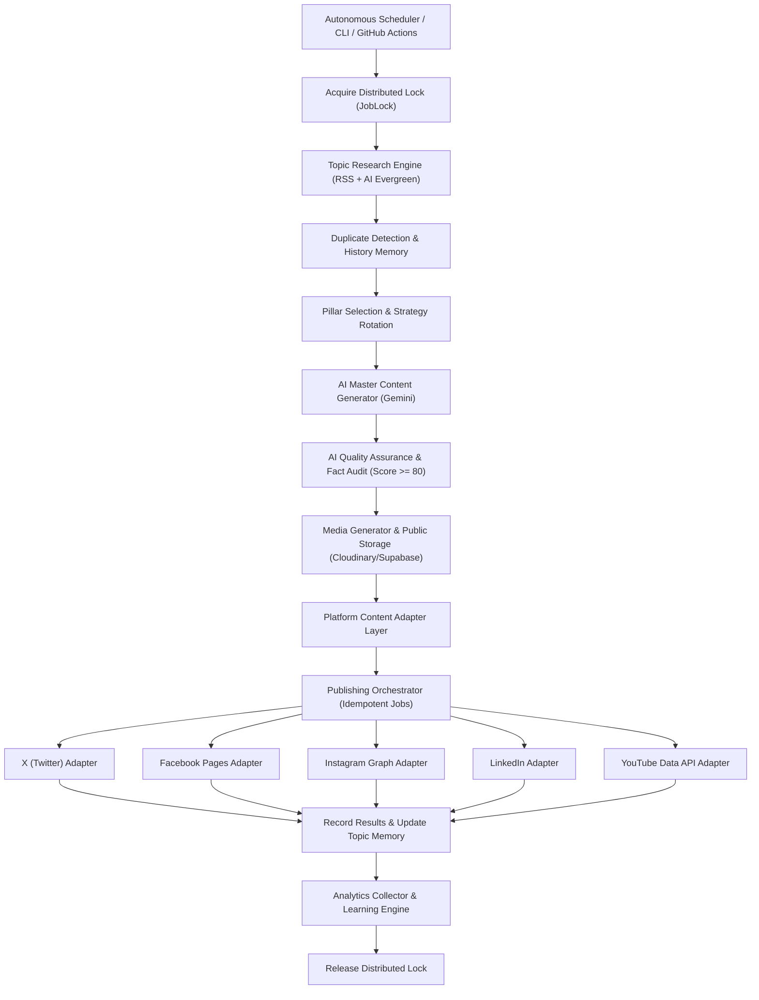

# Autonomous AI Social Media Content & Publishing Engine (`autonomous-social-publisher`)

A production-grade, headless, fully autonomous AI social media content generation and multi-platform publishing engine built with Node.js, TypeScript, Google Gemini, and Supabase PostgreSQL.

The system autonomously researches daily news and evergreen topics, aligns content with brand guidelines, generates master technical content packages, validates accuracy via an AI quality assurance agent, produces media concepts, adapts native copy for each social platform, and publishes daily batches without human intervention.

---

## 1. Project Overview & Features

- **Autonomous Topic Discovery**: Pulls real-time articles via configurable RSS feeds (TechCrunch, Hacker News, MIT Tech Review, etc.) and falls back to autonomous AI evergreen ideation when external feeds are unavailable.
- **Persistent Long-Term Memory**: Stores topic history, normalized content fingerprints, and embeddings in Supabase PostgreSQL (with pgvector support and resilient offline in-memory fallback) to prevent topic repetition.
- **Structured AI Generation & QA**: Employs `@google/genai` (Gemini 2.5 Flash / Pro) with strict Zod schema validation, automated repair loops, and a dedicated AI Fact-Checking / Quality Assurance auditor (quality threshold: 80/100).
- **Multi-Platform Native Adaptation**: Tailors one master idea into 5 native formats:
  - **X (Twitter)**: High-impact opening, concise 280-char enforcement, filtered hashtags.
  - **Facebook Pages**: Community discussion format, conversational paragraphs, engagement questions.
  - **Instagram**: Visual narrative hook, aesthetic line spacing, carousel breakdown captions, public HTTPS media container support.
  - **LinkedIn**: Authoritative thought-leadership format, architectural trade-offs, professional engineering tone.
  - **YouTube**: Complete video production package (SEO title, description, tags, scene-by-scene script with voiceover and visual prompts).
- **Decoupled Publishing Orchestrator**: Independent per-platform job runners with exponential backoff retries, deterministic idempotency keys, and partial failure tolerance (e.g., an Instagram failure never aborts LinkedIn or X).
- **Distributed Scheduler & Locks**: Timezone-aware scheduling (Europe/Bucharest default, 1–2 batches/day), randomized jitter windows, and database-backed distributed locks to prevent overlapping runs.
- **Headless & CLI-Driven**: Zero web dashboard overhead. Fully controlled via environment variables, JSON configs, Markdown brand knowledge, and a rich CLI.

---

## 2. Core Architecture Pipeline



---

## 3. System Requirements

- **Runtime**: Node.js **20.x** or **22.x LTS**
- **Package Manager**: npm **10+** (or pnpm / yarn)
- **Database**: Supabase PostgreSQL (or any standard PostgreSQL instance with `pgvector`); includes zero-dependency local in-memory fallback for local dev.
- **Operating System**: Linux, macOS, or Windows 10/11 (PowerShell).

---

## 4. Installation & Quick Start

### 1. Clone & Install Dependencies
```bash
git clone <repository-url>
cd auto-media

# Install dependencies
npm install
```

### 2. Configure Environment Variables
Copy the example environment file and customize your API credentials:
```bash
cp .env.example .env
```
*(Note: If no API keys are provided, the engine automatically runs in **Mock/Dev Mode**, allowing full offline verification of all workflows!)*

### 3. Build & Verify
```bash
# Typecheck TypeScript codebase
npm run typecheck

# Run test suite (40 unit & integration tests)
npm test

# Build production artifacts
npm run build
```

---

## 5. Configuration Files

All operational behaviors are configurable without altering TypeScript source code:

| File | Purpose |
|------|---------|
| [`config/publishing.json`](file:///c:/Users/USER/Desktop/peeples%20sites/auto-media/config/publishing.json) | Posts per day, schedule times, timezone, quality threshold (80), deduplication lookback (30 days), retry policy. |
| [`config/platforms.json`](file:///c:/Users/USER/Desktop/peeples%20sites/auto-media/config/platforms.json) | Platform enablement flags, character limits, max hashtags, media requirements, and privacy defaults. |
| [`config/content-pillars.json`](file:///c:/Users/USER/Desktop/peeples%20sites/auto-media/config/content-pillars.json) | Content pillars with target percentages (e.g., Educational Tips: 30%, Industry News: 20%, Tutorials: 20%, Thought Leadership: 15%, Case Studies: 10%, Promotional: 5%). |
| [`config/rss-sources.json`](file:///c:/Users/USER/Desktop/peeples%20sites/auto-media/config/rss-sources.json) | Active RSS feed URLs, categories, and refresh priorities. |

---

## 6. Environment Variables Guide

| Variable | Description | Default / Example |
|----------|-------------|-------------------|
| `NODE_ENV` | Runtime environment | `development` / `production` |
| `TIMEZONE` | Timezone for scheduled runs | `Europe/Bucharest` |
| `POSTS_PER_DAY` | Number of daily batches | `2` |
| `DRY_RUN` | Global dry-run switch | `false` |
| `AI_PROVIDER` | AI provider (`gemini` or `mock`) | `gemini` |
| `GEMINI_API_KEY` | Google Gemini API key | `AIzaSy...` |
| `AI_MODEL` | Gemini model name | `gemini-2.5-flash` |
| `SUPABASE_URL` | Supabase project URL | `https://xyz.supabase.co` |
| `SUPABASE_SERVICE_ROLE_KEY` | Supabase service role secret | `eyJhbGciOi...` |
| `CLOUDINARY_CLOUD_NAME` | Cloudinary cloud identifier | `my-brand-cloud` |
| `CLOUDINARY_API_KEY` | Cloudinary API key | `1234567890` |
| `CLOUDINARY_API_SECRET` | Cloudinary secret | `abcdef...` |
| `X_API_KEY` / `X_ACCESS_TOKEN` | X API v2 credentials | `...` |
| `FACEBOOK_PAGE_ID` / `FACEBOOK_ACCESS_TOKEN` | Meta Graph API Page token | `...` |
| `INSTAGRAM_ACCOUNT_ID` / `INSTAGRAM_ACCESS_TOKEN` | Instagram Graph API credentials | `...` |
| `LINKEDIN_ACCESS_TOKEN` / `LINKEDIN_ORGANIZATION_ID` | LinkedIn REST API credentials | `...` |
| `YOUTUBE_CLIENT_ID` / `YOUTUBE_REFRESH_TOKEN` | YouTube Data API v3 OAuth credentials | `...` |
| `TOKEN_ENCRYPTION_KEY` | 32-byte secret for encrypted credentials | 64-char hex string |

---

## 7. Database & Supabase Migrations

The database schema is defined in [`database/migrations/001_initial_schema.sql`](file:///c:/Users/USER/Desktop/peeples%20sites/auto-media/database/migrations/001_initial_schema.sql).

### Tables Created:
1. `publishing_runs`: Execution status, timing, counts, and error logs.
2. `content_topics`: Topic pool, scores, sources, and usage status.
3. `content_items`: Master content packages, quality scores, and media prompts.
4. `platform_posts`: Native post variants, platform post IDs, URLs, and status.
5. `research_sources`: Ingested articles and SHA-256 topic hashes.
6. `content_memory`: Long-term content memory and embeddings.
7. `media_assets`: Image/video metadata and public hosting URLs.
8. `platform_credentials`: Encrypted OAuth tokens and expiration tracking.
9. `analytics`: Platform engagement metrics (impressions, reach, likes, clicks).
10. `scheduler_locks`: Distributed execution locks with TTL.

### Applying Migrations:
- **Supabase Dashboard**: Copy the SQL file contents into the Supabase SQL Editor and run it.
- **Supabase CLI**: Run `supabase db push`.
- **Local Dev**: Run `npm run migrate` to inspect migration file integrity.

---

## 8. CLI Commands Reference

```bash
# 1. System status & configuration inspection
npm run status

# 2. Connection and credential verification
npm run test:connections

# 3. Autonomous topic research (RSS + AI ideation)
npm run research:now
node dist/cli/index.js research --count 5

# 4. Content generation & QA inspection for specific/autonomous topic
npm run generate:now
node dist/cli/index.js generate --topic "Microservices vs Modular Monoliths in 2026"

# 5. Full End-to-End Dry Run (safe simulation, zero external broadcasts)
npm run dry-run

# 6. Live publishing run
npm run publish:now
node dist/cli/index.js publish --platforms x,linkedin

# 7. Collect platform analytics & update learning memory
npm run analytics

# 8. Force release any stale scheduler lock
npm run scheduler:unlock

# 9. Continuous background scheduler daemon
node dist/main.js --daemon
```

---

## 9. Platform Integrations & Setup Guide

### X (Twitter)
- **API**: Twitter API v2 (`POST https://api.twitter.com/2/tweets`).
- **Required Credentials**: `X_API_KEY`, `X_API_SECRET`, `X_ACCESS_TOKEN`, `X_ACCESS_TOKEN_SECRET`.
- **App Permissions**: Set user authentication settings to **Read and Write**.
- **Constraints**: 280 character hard limit (handled automatically with smart ellipsis truncation and hashtag preservation).

### Facebook Pages
- **API**: Meta Graph API v20.0 (`POST /{page-id}/feed`).
- **Required Credentials**: `FACEBOOK_PAGE_ID`, `FACEBOOK_ACCESS_TOKEN` (Long-lived Page Access Token).
- **Permissions Required**: `pages_manage_posts`, `pages_read_engagement`.
- **Note**: Does not post to personal profiles (compliant with Meta policy).

### Instagram (Professional / Creator Accounts)
- **API**: Instagram Graph API (`POST /{ig-user-id}/media` -> Container polling -> `POST /{ig-user-id}/media_publish`).
- **Required Credentials**: `INSTAGRAM_ACCOUNT_ID`, `INSTAGRAM_ACCESS_TOKEN`.
- **Hosting Rule**: Media URLs **must** be publicly accessible over HTTPS (handled via Cloudinary or Supabase Storage).
- **Aspect Ratios**: 1:1 square or 4:5 vertical (validated prior to upload).

### LinkedIn
- **API**: LinkedIn REST API v2 (`POST /v2/ugcPosts`).
- **Required Credentials**: `LINKEDIN_ACCESS_TOKEN`, and either `LINKEDIN_ORGANIZATION_ID` (for company pages) or `LINKEDIN_PERSON_URN` (for personal profiles).
- **Scopes Required**: `w_member_social` or `w_organization_social`.

### YouTube
- **API**: YouTube Data API v3 (`POST /upload/youtube/v3/videos?uploadType=resumable`).
- **Required Credentials**: `YOUTUBE_CLIENT_ID`, `YOUTUBE_CLIENT_SECRET`, `YOUTUBE_REFRESH_TOKEN`.
- **Privacy Default**: Defaulted to `private` for safe initial verification.
- **Fail-safe**: If video generation is not configured, YouTube upload is safely skipped without blocking other platforms.

---

## 10. Autonomous CI/CD Workflows (GitHub Actions)

Located in [`.github/workflows/`](file:///c:/Users/USER/Desktop/peeples%20sites/auto-media/.github/workflows/):

1. **`daily-publishing.yml`**: Scheduled daily run at 10:00 & 17:00 Europe/Bucharest (07:00 & 14:00 UTC) with concurrency controls to prevent overlapping jobs.
2. **`manual-run.yml`**: Manual workflow dispatch with parameters for `dry_run`, `posts_count`, `platforms`, and `topic_override`.
3. **`maintenance.yml`**: Periodic token health validation, analytics collection, and stale lock cleanup.

---

## 11. Security & Operational Safety

- **Secret Masking**: The custom logger automatically scrubs authorization tokens, Bearer headers, and API keys before outputting to stdout or disk.
- **AES-256-GCM Encryption**: OAuth refresh tokens in database repositories are encrypted using `TOKEN_ENCRYPTION_KEY`.
- **Deterministic Idempotency**: Every platform post generates a unique idempotency key:
  `idemp_{runId}_{platform}_{sha256(topic + angle)}`
  Preventing duplicate posts even if network drops or runs overlap.
- **Circuit Breakers & Retries**: Exponential backoff with jitter and retry limits (default: 3 retries) respects HTTP 429 / `Retry-After` headers.

---

## 12. Free-Tier-First Cost Breakdown

| Service | Free Tier Allowance | Strategy |
|---------|---------------------|----------|
| **GitHub Actions** | 2,000 minutes/month | Runs take ~1-2 mins each (60-120 mins/month total). |
| **Supabase** | Free project (500MB DB, 1GB storage) | Ample for several years of post history and metadata. |
| **Google Gemini API** | Free tier available (RPM/TPM limits) | Uses `gemini-2.5-flash` for high speed, low token consumption, and minimal cost. |
| **Cloudinary** | 25 monthly credits (~25,000 transforms/images) | Ample for 30–60 monthly social post images. |
| **RSS Feeds** | 100% Free | Unlimited article ingestion with client-side deduplication. |

---

## 13. License

MIT License. Designed and engineered for autonomous social media publishing.
